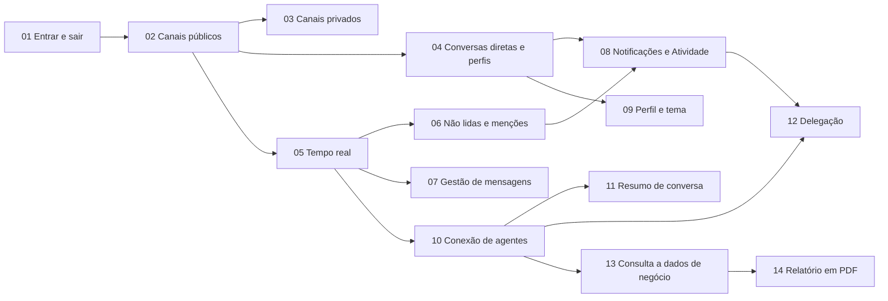

# Roadmap: Full Cycle Chat

Este documento é dono da lista de funcionalidades do produto, das dependências entre elas e do
status de cada uma. As fases do produto e os critérios para passar de uma à outra ficam no
`docs/product-brief.md`, seção "Roadmap".

## Status

Cada funcionalidade passa por estes status, nesta ordem (`AGENTS.md`, "Planejamento"):

| Status | Quando |
| --- | --- |
| planejada | Está na lista, ainda sem PRD. |
| PRD pronto | O `prd.md` foi escrito pela skill `/prd`. |
| spec pronta | O `spec.md` foi escrito. |
| em andamento | Saiu o primeiro commit de plano de uma tarefa dela. |
| concluída | Foi entregue no PR da última tarefa dela. |

O nome da funcionalidade vira link para a pasta dela em `docs/funcionalidades/` quando o PRD é
criado.

## Fase 1: fechar o MVP

| # | Funcionalidade | Ao final, a pessoa consegue… | Depende de | Status |
| --- | --- | --- | --- | --- |
| 01 | [Entrar e sair](funcionalidades/01-entrar-e-sair/) | entrar com e-mail e senha numa conta criada pela empresa e sair; a sessão vale no navegador todo | — | concluída |
| 02 | [Canais públicos](funcionalidades/02-canais-publicos/) | criar um canal público e conversar nele com todo o workspace | 01 | concluída |
| 03 | [Canais privados](funcionalidades/03-canais-privados/) | criar um canal privado, convidar pessoas e conversar só com quem foi convidado | 02 | PRD pronto |
| 04 | Conversas diretas e perfis | buscar alguém por nome ou @usuário, ver o perfil e abrir uma Conversa direta | 02 | planejada |
| 05 | Tempo real | ver as mensagens chegarem na hora, o aviso de "digitando", o histórico paginado e recuperar o que perdeu numa queda de conexão | 02 | planejada |
| 06 | Não lidas e menções | mencionar pessoas e ver a contagem de não lidas e de menções em cada conversa | 05 | planejada |
| 07 | Gestão de mensagens | responder citando, copiar, editar e apagar as próprias mensagens, com a mudança aparecendo para todos na hora | 05 | planejada |
| 08 | Notificações e Atividade | receber alerta na tela e no navegador por Menção, Mensagem em Conversa direta e Tarefa delegada, clicar para ir à mensagem e ver tudo na tela Atividade | 04, 06 | planejada |
| 09 | Perfil e tema | editar nome, cargo, telefone, status e presença e escolher o tema claro ou escuro | 04 | planejada |
| 10 | Conexão de agentes | como administrador, conectar e desconectar um Agente; qualquer pessoa vê os Agentes e a quem pedir, menciona um e recebe a resposta na conversa | 05 | planejada |
| 11 | Resumo de conversa | pedir um resumo com recorte e, sem recorte, escolher por botões; responder ao Agente sem mencioná-lo de novo | 10 | planejada |
| 12 | Delegação | pedir ao Agente uma Delegação, que cria uma Tarefa delegada; quem recebe é notificado, conclui ou reabre, e quem delegou é avisado | 08, 10 | planejada |
| 13 | Consulta a dados de negócio | perguntar números de vendas em linguagem natural e receber a resposta na conversa; quem não tem Permissão de dados vê a resposta bloqueada | 10 | planejada |
| 14 | Relatório em PDF | pedir o relatório em PDF, seguir conversando e baixar o arquivo quando o Agente entregar | 13 | planejada |

### Mapa de dependências

A seta vai da funcionalidade para a que depende dela. Só as dependências diretas aparecem.

## Próximas fases

Estes itens ainda não têm número. Recebem um quando forem recortados em funcionalidades.

- **Fase 2, operar como produto:** cadastro e convite de pessoas, tela de papéis e permissões,
  remoção de membros de canal privado, entrar e sair de canais, busca de mensagens, threads,
  reações e anexos de arquivo.
- **Sem fase:** gráfico na conversa, relatório agendado e Agente que age sem ser chamado.
